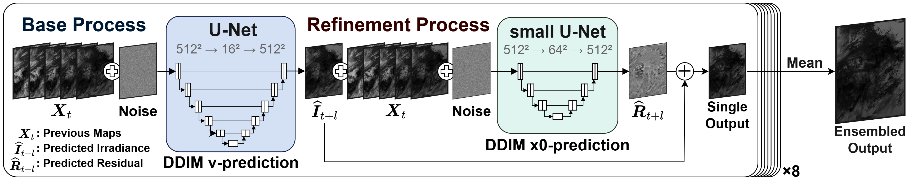
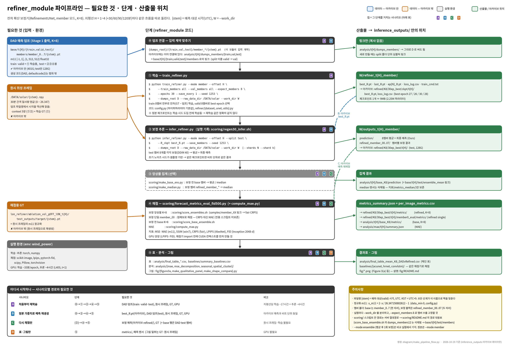

# Diffusion-Based Residual Refiner



&nbsp;한반도 일대 일사량을 디퓨전으로 예측하는 파이프라인의 보정 프로세스입니다. 베이스 모델 예측의 잔차를 생성하여 결과를 보정합니다. 문서 설명의 일부는 Claude Code에 의해 작성되었습니다.

- 의존성: `torch`, `numpy`
- 핵심 원리: 잔차 `residual = GT − y_base`를 생성하는 x0-prediction diffusion 학습. 추론 시 DDIM으로 residual을 샘플링한 후, 합하여 보정 `y_refined = y_base + residual`
- 보정기 학습 과정에서 한 예측 시점에 대하여 총 8개의 서로 다른 베이스 모델 잔차를 학습합니다. 잔차 분포 구조를 최대한 학습함으로써 확률적 예측을 효과적으로 보정할 수 있도록 만들어졌습니다.

> [📖 **기술 문서**](https://hollyriver.github.io/DiffusionRefiner/) (Claude Code로 제작됨)

## 데이터 구조

```
{dumps_root}/                      # config.py 또는 --dumps_root
├── train/member_00/2021-06-01_0600.pt    # 파일명 = "예측 대상" 타임스탬프
│         member_01/...                   # 멤버 여러 개 = 앙상블 (본 실험에서는 8개를 사용)
├── val/member_00/...                     # 검증용 (없으면 경고 후 진행)
└── test/member_00/...                    # 최종 보정 대상

{raw_data_dir}/2021-06-01_0600.npy        # 원본 프레임 (30분 간격 raw 값)
```

&nbsp;Base 모델 작업자에게서 계승된 설정입니다.

- Base 모델 예측 덤프 `.pt`: shape `(1,H,W)` 또는 `(H,W)`, 값 범위 [-1, 1] (`2*(x-min)/(max-min)-1`)
- 원본 일사량 `.npy`: 물리 단위 raw 값. 정규화되지 않음

## 사용법

연구에서 쓴 설정은 **K=8 앙상블 멤버 보정**입니다. 멤버 8개를 모두 학습 데이터로 쓰고,
test에서는 멤버 8개를 각각 보정한 뒤 평균해 최종 예측을 만듭니다.

```bash
DUMPS=/path/to/dumps        # Base 모델 예측 덤프 위치: {split}/member_XX/{timestamp}.pt
RAW=/path/to/raw_frames     # 원본 일사량 데이터 위치: {timestamp}.npy
WORK=./work/k8              # 실험 결과 저장 폴더

# 1) 학습
python train_refiner.py --mode member --offset 1 \
    --train_members all --expect_members 8 \
    --dumps_root $DUMPS --raw_data_dir $RAW --work_dir $WORK --gpu 0

# 2) 보정 추론
python infer_refiner.py --mode member --offset 1 --save_members \
    --dumps_root $DUMPS --raw_data_dir $RAW --work_dir $WORK --gpu 0
```

- horizon(t+1 ~ t+4)마다 `--offset`만 바꿔 따로 실행합니다. refiner도 horizon마다 따로 학습됩니다.
- 경로 세 개는 `config.py`에 적어 두면 명령에서 뺄 수 있습니다.
- epoch 수(30) 등 나머지는 기본값 그대로 쓰면 됩니다. 기본값은 아래 [인자](#인자) 표에 있습니다.

**산출물** (`{N}` = `--offset`)

| 경로 | 내용 |
|---|---|
| `$WORK/refiner_t{N}_member/best_R.pt` | 검증 손실이 가장 낮은 epoch의 가중치. 추론은 이것을 씁니다 |
| `$WORK/refiner_t{N}_member/last_R.pt`, `ep{E}_R.pt` | 마지막 epoch / epoch별 가중치 (개당 ~9MB) |
| `$WORK/refiner_t{N}_member/loss_log.csv`, `train_cmd.txt` | epoch별 손실·LR / 실행한 명령 기록 |
| `$WORK/outputs_t{N}_member/prediction/{timestamp}.pt` | **최종 예측** (보정본 8개의 평균) |
| `$WORK/outputs_t{N}_member/refined_member_00 … 07/` | 멤버별 보정본 (`--save_members`일 때, CRPS 채점에 필요) |

예측 파일은 값 범위 [-1, 1]의 `(1,H,W)` 텐서입니다. 물리 단위로 되돌리려면 `x_raw = (x+1)/2*(max-min)+min`.

## 인자

학습(`train_refiner.py`)과 추론(`infer_refiner.py`)에 **같은 `--offset`, `--work_dir`** 을 줘야
추론이 학습한 체크포인트를 찾습니다. 기본값이 `config.py`로 적힌 인자는 그 파일 값을 따릅니다.

### 공통

| 인자 | 기본값 | 설명 |
|---|---|---|
| `--mode` | (필수) | `member`: 멤버마다 보정한 뒤 평균 (연구 채택). `ensemble`: 멤버 평균을 한 번만 보정 (비교 실험에서 열세, 미채택) |
| `--offset N` | (필수) | 예측 horizon. 마지막 입력 프레임에서 N프레임(N×30분) 뒤 |
| `--dumps_root` | `config.py` | 베이스 모델 예측 덤프 폴더 |
| `--raw_data_dir` | `config.py` | 원본 프레임 폴더. context 5장과 GT를 여기서 읽습니다 |
| `--work_dir` | `./work` | 체크포인트·출력 폴더. 하위 폴더 이름(`refiner_t{N}_member`)이 설정과 무관하게 같으므로 실험마다 따로 지정하세요 |
| `--gpu` | `0` | GPU 번호. `-1`이면 CPU |
| `--seed` | `1253` | 학습: 초기화·셔플·노이즈 고정 (같은 시드·설정이면 같은 가중치). 추론: DDIM 초기 노이즈 고정 |
| `--batch_size` | `4` | |

### 학습 전용

| 인자 | 기본값 | 설명 |
|---|---|---|
| `--train_members` | `first` | `all`: 모든 멤버로 학습 (K=8 설정, 타임스탬프당 샘플 K개). `first`: member_00만 |
| `--val_members` | `all` | 검증에 쓸 멤버. `first`면 member_00만 써서 검증 시간이 1/K로 줄어듭니다 |
| `--expect_members K` | `0` (끔) | 찾은 멤버 수가 K가 아니면 바로 중단. split 폴더가 심링크면 멤버가 늘어도 에러 없이 K가 바뀌므로 꼭 지정하세요 |
| `--epochs` | `30` | |
| `--warmup_epochs` | `10` | 선형 warmup 뒤 코사인 감소 |
| `--lr` / `--min_lr` | `1e-4` / `1e-6` | |
| `--weight_decay` | `1e-4` | |
| `--save_every` | `1` | N epoch마다 `ep{E}_R.pt` 저장 (`0`이면 끔). 나중에 epoch별 비교·재현이 필요할 수 있으니 끄지 않기를 권장 |

### 추론 전용

| 인자 | 기본값 | 설명 |
|---|---|---|
| `--save_members` | 꺼짐 | 멤버별 보정본도 저장. CRPS 같은 앙상블 지표를 채점하려면 필요 |
| `--R_ckpt` | `best_R.pt` | 다른 체크포인트를 쓸 때 경로 지정 (예: `last_R.pt`) |
| `--split` | `test` | 보정할 split |
| `--ddim_steps` | `40` | DDIM 샘플링 스텝 수 |
| `--shards N` / `--shard i` | `1` / `0` | 여러 GPU로 나눠 실행할 때 사용. 전체를 N조각으로 나눠 i번째(0부터)만 처리 |

여러 GPU로 나눌 때는 `--shard`만 바꿔 GPU마다 실행합니다. 각 조각이 서로 다른 파일을 쓰므로 같은
`--work_dir`에 그대로 모입니다. 초기 노이즈가 샘플 이름으로 정해지므로 한 번에 돌린 결과와 같습니다
(배치 구성이 달라져 생기는 1e-7 수준의 부동소수점 차이만 있음).

```bash
python infer_refiner.py --mode member --offset 1 --save_members --gpu 0 --shards 2 --shard 0 --work_dir $WORK ...
python infer_refiner.py --mode member --offset 1 --save_members --gpu 1 --shards 2 --shard 1 --work_dir $WORK ...
```

### 그 밖의 인자

- 데이터 규칙이 다를 때: `--member_glob` (멤버 폴더 패턴, 기본 `member_*`), `--dump_value_range` (`m11` | `raw`). 아래 "적응 가이드" 참고
- 빠른 점검용: `--max_iters_per_epoch` (학습), `--max_samples` (추론), `--num_workers`
- 중단된 학습 이어하기: `--resume_ckpt ep{E}_R.pt --start_epoch {E} --init_best_val {기존 best의 val 손실}`
- 재현성: `--cudnn_deterministic` (비트 단위 재현에 더 가깝게, 느려짐), `--val_stochastic` (검증 노이즈를 매 epoch 새로 뽑던 2026-09-08 이전 동작)

## 채점 (정본 수치 산출 파일)

논문 표의 수치를 만든 채점기·집계·실행 스크립트 원본 사본은 [`scoring/`](scoring/README.md)에 있습니다
(채점 의존성: `scikit-image`, `lpips`, `pytorch-fid`).

## 전체 흐름도



## 모듈 유효성 검증

데이터 없이 모듈 자체를 검증하려면 (CPU만으로 수 분):

```bash
python tests/run_smoke.py     # 마지막 줄 SMOKE OK 확인
python tests/test_utils.py
python tests/test_dataset.py
```

## 적응 가이드 — 다른 데이터에 쓸 때

데이터가 위 "데이터 구조"와 다를 때만 보면 됩니다. 대부분 `config.py` 한 곳만 고치면 됩니다.

| # | 이런 경우 | 고칠 곳 |
|---|---|---|
| 1 | 파일명의 시각 형식이 다름 (예: `20210601T0600`) | 원본 프레임 이름: `config.py`의 `filename_format`<br>덤프 이름: `refiner/utils.py`의 `DT_FORMATS`에 형식 추가 |
| 2 | 멤버 폴더 이름이 `member_XX`가 아님 (예: `seed0/`) | `config.py`의 `member_glob` (예: `"seed*"`)<br>번호는 두 자리로 맞추세요. 한 자리 번호로 10개를 넘으면 `member_1, member_10, member_2…` 순으로 정렬돼 보정본 번호가 어긋납니다 |
| 3 | 덤프 값이 [-1, 1]이 아니라 물리 단위 | `config.py`의 `dump_value_range = "raw"` |
| 4 | 프레임 간격이 30분이 아님, 또는 입력 프레임이 5장이 아님 | `config.py`의 `frame_interval_minutes`, `num_context` |
| 5 | 정규화 min/max가 다름 | `config.py`의 `data_min`, `data_max` (베이스 모델이 덤프를 만들 때 쓴 값과 같아야 함) |
| 6 | 원본 프레임이 `.npy`가 아님 | `refiner/dataset.py`의 `_Base._load_raw_m11` 함수 하나 (파일을 읽어 [-1, 1] 범위 `(1,H,W)` 텐서로 반환) |
| 7 | 덤프 파일명이 예측 대상 시각이 아니라 예측을 만든 시각 | `refiner/dataset.py`의 `build_items`, `build_multi_items`에서 파일명 시각에 `offset × 간격`을 더해 대상 시각으로 바꾸기. **에러 없이 엉뚱한 정답과 짝지어지므로** 직접 확인하세요 |

고친 뒤에는 학습을 짧게 돌려(`--epochs 1 --max_iters_per_epoch 2`) 로그의 `[items] ... built=` 숫자를 봅니다.
0이거나 너무 적으면 같은 줄의 숫자로 원인을 찾을 수 있습니다.

- `no_dt`가 많음: 덤프 파일명을 읽지 못함 → 1번(`DT_FORMATS`)
- `miss_tgt`, `miss_ctx`가 많음: 원본 프레임을 찾지 못함 → 1번(`filename_format`) 또는 4번(간격)
  (원본에 빠진 시각이 있으면 몇 개는 정상적으로 생깁니다)

## 학습 데이터가 어떻게 구성되는지 (참고)

Refiner 학습 샘플 하나 = (덤프된 y_blur, 원본에서 읽은 context 5장, 원본 GT target).
context/GT는 **덤프 파일명의 타임스탬프에서 역산**해 원본 디렉토리에서 찾습니다:

```
target_dt       = 덤프 파일명의 시각
last_context    = target_dt - offset × frame_interval
context 5장     = last_context에서 끝나는 연속 5프레임
```

원본에 해당 프레임이 없는 샘플은 자동 스킵되고 개수가 로그에 출력됩니다.
